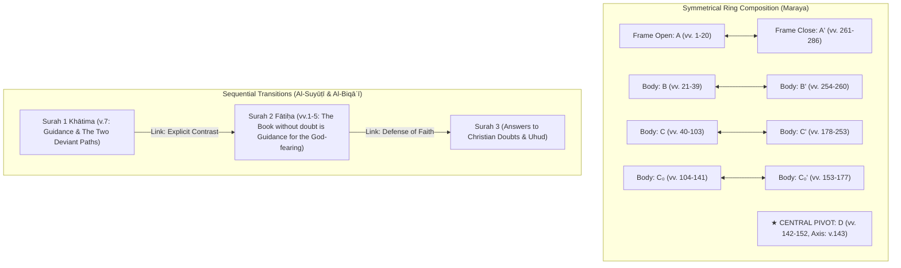

# Research: Maraya Ring Composition, Al-Biqāʿī Surah Transitions, and Munāsabāt Schema

> **Document Version**: 1.0.0  
> **Status**: Completed  
> **Target Milestone**: Milestone 3: Munāsabāt & Surah Structure Tab ([Roadmap #4](https://github.com/bilalbox/lenses/issues/4))  
> **Origin Ticket**: [#15](https://github.com/bilalbox/lenses/issues/15)

---

## 1. Executive Summary & Literary Domain Context

The Quran possesses a sophisticated macro-architectural cohesion recognized across both classical Arabic rhetorical traditions (_‘ilm al-munāsabāt_ — علم المناسبات) and modern literary structural analysis (_ring composition_ / _concentric symmetry_ / _chiasmus_ — التناظر والتركيب الدائري).

Rather than reading the Quran solely as a linear succession of independent verses, structural analysis reveals that:
1. **Surahs Fold Symmetrically**: Chapters frequently exhibit concentric symmetry ($A - B - C - X - C' - B' - A'$), where an opening thematic frame echoes a closing frame, intermediate narrative/legislative bodies balance each other in reverse order, and a deliberate **central pivot** (_wasaṭ_ / محور) sits at the heart of the surah holding its core theological declaration.
2. **Surahs Connect Sequentially**: The conclusion (_khātima_) of Surah $N$ deliberately prepares and links directly into the opening (_fātiḥa_) and central objective (_maqṣad_) of Surah $N+1$.

This document establishes the empirical datasets, mathematical layout models, and static JSON schema to deliver **Milestone 3 (Munāsabāt & Surah Structure Tab)** in Lenses.



---

## 2. Primary Sources & Empirical Datasets

### 2.1 The Maraya Structural Dataset (Ayah Labs, Feras Mansi)

- **Primary Source**: Ayah Labs research preprint: _"Structural Centering in the Qur'an: A Corpus-Wide Analysis of Pivot Positioning Across 114 Surahs"_ (Feras Mansi, March 2026) and the live interactive platform [maraya.app](https://maraya.app).
- **Corpus Coverage**: **100% of the Quran** (all 114 surahs).
- **Core Findings**:
  - The mean absolute offset of structural pivots from the exact geometric center of surahs is **0.066**, yielding a statistical test score of $Z = -13.58$ ($p < 10^{-41}$), decisively rejecting the hypothesis that pivot positioning is random.
  - Symmetrical centering holds consistently across long Madinan legislative surahs (e.g. Al-Baqarah, Āl 'Imrān, Al-Mā'idah) and short Meccan poetic surahs (e.g. Al-Ikhlāṣ, Al-Kawthar, Al-'Aṣr).
- **Structural Taxonomy**:
  Each surah belongs to one of 5 canonical architectural families:
  1. **Compressed Crystal** (`family_id: 3`): Tightly woven surah — one idea, one center (e.g. Al-Fātiḥah, Al-Ikhlāṣ, Al-Kawthar).
  2. **Distributed Field** (`family_id: 5`): A surah unfolding across a wide, varied landscape (e.g. Al-Baqarah, Al-Anfāl, Al-Tawbah).
  3. **Narrative Pillar** (`family_id: 1`): Long narrative surah turning through episodic storytelling (e.g. Yūsuf, Al-Kahf, Maryam, Ṭāhā).
  4. **Polemical Hinge** (`family_id: 4`): Surah turning through rigorous theological argument and communal address (e.g. Āl 'Imrān).
  5. **Sequential Staircase / Diptych**: Symmetrical paired structures with dual balancing cores.
- **Pivot Functions**:
  - `THEOLOGICAL_DECLARATION` (e.g. 1:5 _Iyyāka na'budu wa-iyyāka nasta'īn_, 112:3 _Lam yalid wa-lam yūlad_)
  - `COMMAND_LEGISLATION` (e.g. 2:142-152 _The Qiblah reorientation & Ummah Wasaṭ_)
  - `COMMUNAL_ADDRESS` (e.g. 3:100-108 _Hold fast to the rope of Allah_)
  - `NARRATIVE_RECOLLECTION` (e.g. 6:74-90 _Abraham discovers pure Tawḥīd_, 12:36-57 _Joseph's prison revelation_)
  - `WARNING_CONSEQUENCE` (e.g. 7:175-179 _The parable of the dog & heedlessness_)
- **Center Logics**:
  - `single_concentration`: A precise, singular central axis (e.g. 2:143, 1:5, 18:54).
  - `compound_seam`: A multi-verse central thematic hinge uniting two balancing halves.

### 2.2 Classical Munāsabāt & Surah Transition Sources

- **Al-Suyūṭī**: _Tanāsuq al-Durar fī Tanāsub al-Suwar_ (تَناسُق الدرر في تَناسُب السوَر), also known as _Asrār Tartīb al-Qur'an_ (Book ID 9992 on Turath / OpenITI).
  - Contains **113 dedicated inter-surah transitions** analyzing why Surah $N$ is placed immediately before Surah $N+1$, demonstrating that the closing verses of Surah $N$ directly dovetail into the opening of Surah $N+1$.
- **Al-Biqāʿī**: _Naẓm al-Durar fī Tanāsub al-Āyāt wa-l-Suwar_ (نظم الدرر في تناسب الآيات والسور), Book ID 9098 on Turath (22 volumes).
  - The standard classical reference for both macro-structural surah goals (_maqāṣid_) and micro-structural verse-to-verse transitions (_tanāsub al-āyāt_).
- **Al-Gharnāṭī**: _Al-Burhān fī Tartīb Suwar al-Qur'an_ (البرهان في ترتيب سور القرآن).
  - Early Andalusian masterwork establishing the thematic necessity of the Uthmānic canonical surah order.
- **QuranDB Enrichment**:
  - `surahGoals` and `revelationSeq` (already compiled into `public/data/quran/manifest.json` in Issue #9) directly ground each surah's central theme and historical revelation sequence.

---

## 3. Structural Block Representation

Every surah in Maraya is broken into contiguous verse blocks ($B_1, B_2, \dots, B_k$).

### 3.1 Block Schema Attributes

Each block possesses:
- `id`: Unique identifier denoting its symmetrical counterpart:
  - Outer frames: `A` and `A′` (or `OPEN` / `CLOSE`)
  - Intermediate bodies: `B` and `B′`, `C` and `C′`, `C₀` and `C₀′`
  - Central pivot: `PIVOT` or `D` (or `CENTER`)
  - Narrative episodes: `N1`, `N2`, `N3`...
  - Transitions: `T1`, `T2`, `T3`...
- `v`: 2-element integer array `[startVerse, endVerse]` (inclusive 1-based Tanzil numbering).
- `role`: Functional classification:
  - `outer_frame_open`, `outer_frame_close`, `frame`
  - `body`, `pivot`, `center`
  - `narrative_1` .. `narrative_7`
  - `transition_1` .. `transition_3`
  - `seam`, `hinge`, `addendum`
- `label`: Concise thematic summary in English (e.g. `"The qiblah pivot"`, `"Three responses to revelation"`).
- `labelAr`: Localized Arabic thematic title.

### 3.2 Canonical Exemplars

#### Surah 1: Al-Fātiḥah (7 verses)

| ID        | Verses | Role                | Thematic Label                          | Symmetric Partner |
| :-------- | :----: | :------------------ | :-------------------------------------- | :---------------- |
| **A**     |  1–3   | `outer_frame_open`  | Praise of the Lord                      | **A′** (v. 7)     |
| **B**     |  4–4   | `body`              | Lord of Judgment                        | **B′** (v. 6)     |
| **PIVOT** |  5–5   | `pivot`             | Worship and reliance (_Iyyāka na'budu_) | _Center Anchor_   |
| **B′**    |  6–6   | `body`              | Prayer for guidance (_Ihdinā al-ṣirāṭ_) | **B** (v. 4)      |
| **A′**    |  7–7   | `outer_frame_close` | The three paths                         | **A** (vv. 1–3)   |

#### Surah 2: Al-Baqarah (286 verses)

| ID      | Verses  | Role    | Thematic Label                             | Symmetric Partner     |
| :------ | :-----: | :------ | :----------------------------------------- | :-------------------- |
| **A**   |  1–20   | `frame` | Three responses to revelation              | **A′** (vv. 261–286)  |
| **B**   |  21–39  | `body`  | Adam and mankind's beginning               | **B′** (vv. 254–260)  |
| **C**   | 40–103  | `body`  | Israel's covenant failure                  | **C′** (vv. 178–253)  |
| **C₀**  | 104–141 | `body`  | Speech discipline & Abrahamic legacy       | **C₀′** (vv. 153–177) |
| **D**   | 142–152 | `pivot` | The Qiblah pivot & Ummah Wasaṭ (v. 143)    | _Center Anchor_       |
| **C₀′** | 153–177 | `body`  | Community formation & trials               | **C₀** (vv. 104–141)  |
| **C′**  | 178–253 | `body`  | Law, social order, and struggle            | **C** (vv. 40–103)    |
| **B′**  | 254–260 | `body`  | Divine authority and faith (Āyat al-Kursī) | **B** (vv. 21–39)     |
| **A′**  | 261–286 | `frame` | The final covenant & prayer                | **A** (vv. 1–20)      |

#### Surah 18: Al-Kahf (110 verses)

| ID     | Verses | Role           | Thematic Label                     | Symmetric Partner   |
| :----- | :----: | :------------- | :--------------------------------- | :------------------ |
| **A**  |  1–8   | `frame`        | The Book with no deviance          | **A′** (vv. 99–110) |
| **N1** |  9–26  | `narrative_1`  | People of the Cave                 | **N4** (vv. 83–98)  |
| **T1** | 27–31  | `transition_1` | No changer of His words            | **T3** (vv. 55–59)  |
| **N2** | 32–44  | `narrative_2`  | Two gardens — pride and humility   | **N3** (vv. 60–82)  |
| **T2** | 45–53  | `transition_2` | This world like passing rain       | _Inner Flank_       |
| **D**  | 54–54  | `pivot`        | Humanity's tendency to dispute     | _Center Anchor_     |
| **T3** | 55–59  | `transition_3` | Nothing prevents belief            | **T1** (vv. 27–31)  |
| **N3** | 60–82  | `narrative_3`  | Moses and the wise servant (Khidr) | **N2** (vv. 32–44)  |
| **N4** | 83–98  | `narrative_4`  | Dhul-Qarnayn and the barrier       | **N1** (vv. 9–26)   |
| **A′** | 99–110 | `frame`        | The Horn blown & righteous reward  | **A** (vv. 1–8)     |

---

## 4. Visual Layout Engine: Symmetrical Ring Composition Visualizer

The UI renderer will utilize custom SVG layout math without external graph dependencies.

### 4.1 Concentric Nested Arcs Geometry

1. **Horizontal Track**:
   - The surah verse line is represented as a normalized continuous track of width $W = 800\text{px}$.
   - Each block $B_i$ with verse span $[v_{\text{start}}, v_{\text{end}}]$ has center coordinate:
     $$x(B_i) = \text{padding} + \frac{(v_{\text{start}} + v_{\text{end}}) / 2 - 1}{\text{verseCount} - 1} \times (W - 2 \times \text{padding})$$
2. **Concentric Symmetrical Arcs**:
   - For each matching pair $(B, B')$ (e.g. $A \leftrightarrow A'$, $B \leftrightarrow B'$):
     - Span distance: $S = |x(B') - x(B)|$.
     - Arc peak height:
       $$y_{\text{peak}} = y_{\text{baseline}} - \text{clamp}(24, S \times 0.38, 140)$$
     - Bézier Curve:
       $$d = \text{M } x(B) \text{ } y_{\text{baseline}} \text{ C } x(B) \text{ } y_{\text{peak}}, \text{ } x(B') \text{ } y_{\text{peak}}, \text{ } x(B') \text{ } y_{\text{baseline}}$$
   - Outer frame arcs arch highest; inner body arcs nest lower, framing the composition.
3. **Focal Pivot Anchor**:
   - The central pivot $X$ ($D$ or `PIVOT`) sits at $x(X)$ with a vertical dashed axis beam and a highlighted focal marker (💎 / ★) displaying the exact axis verse (e.g. `2:143`).
4. **Block Segment Bar**:
   - Beneath the arcs, a segmented horizontal bar displays all blocks colored by role (`frame`: Teal, `body`: Indigo, `pivot`: Gold, `narrative`: Amber).
   - Clicking any block highlights the corresponding counterpart block and scrolls to the verse range.

```
       ┌─────────────────────────── A <-> A' (Outer Frame) ───────────────────────────┐
       │     ┌───────────────────── B <-> B' (Inner Body) ─────────────────────┐      │
       │     │     ┌─────────────── C <-> C' (Core Law) ───────────────┐       │      │
       │     │     │                                                   │       │      │
       │     │     │                     [★ PIVOT]                     │       │      │
       ▼     ▼     ▼                     v.142-152                     ▼       ▼      ▼
    [  A  ][  B  ][  C  ][ C₀ ]       [    D    ]       [ C₀' ][  C' ][  B' ][  A' ]
    1-20  21-39  40-103 104-141       (Axis: 143)       153-177 178-253 254-260 261-286
```

### 4.2 Inter-Surah Transition Card

Beneath the ring composition visualizer, a dedicated **Munāsabāt Card** connects Surah $N$ to Surah $N+1$:
- **Next Surah Heading**: Title, phonetic name, and revelation order.
- **Al-Suyūṭī's Exegetical Link (_Tanāsuq al-Durar_)**: Classical exposition detailing how the last verse of Surah $N$ seamlessly dovetails with the first verse of Surah $N+1$.
- **Al-Biqāʿī's Structural Purpose (_Naẓm al-Durar_)**: Macro-thematic connection between the core mission of both chapters.
- **Quick Jump Action**: Single-click button navigating directly to Surah $N+1$.

---

## 5. TypeScript Definitions & Static Data Delivery Budget

### 5.1 Static Delivery Budget

- **Zero Runtime Computational Overhead**: Like syntax and mutashābih, all block ranges, role tags, and transition notes are precomputed at build time.
- **Lazy-Loaded Surah Files**: 114 static JSON files in `public/data/quran/structure/001.json` .. `114.json` (~2–4 KB each).
- **Core Bundle Impact**: Zero bloat to initial page load.

### 5.2 TypeScript Schema (`src/lib/types.ts`)

```typescript
export type StructureRole =
	| "outer_frame_open"
	| "outer_frame_close"
	| "frame"
	| "body"
	| "pivot"
	| "center"
	| "narrative"
	| "transition"
	| "seam"
	| "hinge"
	| "addendum";

export interface StructureBlock {
	id: string; // "A", "B", "C", "D", "PIVOT", "C′", "B′", "A′"
	v: [number, number]; // [startAyah, endAyah] inclusive
	role: StructureRole;
	label: string; // English thematic label
	labelAr?: string; // Arabic thematic label
	pairId?: string; // Corresponding block ID (e.g. "A′" for "A")
}

export interface SurahStructureFile {
	sura: number;
	nameAr: string;
	nameEn: string;
	verseCount: number;
	family: {
		id: number;
		name: string;
		description: string;
	};
	pivot: {
		verse: string; // "142–152 (axis: v.143)"
		offset: number; // -0.0017
		centerLogic: "single_concentration" | "compound_seam";
		function: string; // "COMMAND_LEGISLATION", "THEOLOGICAL_DECLARATION", etc.
	};
	form: "compressed" | "distributed";
	semantic: "concentrated" | "diffuse" | "transitional";
	blocks: StructureBlock[];
	transitionToNext?: {
		targetSura: number;
		targetNameAr: string;
		targetNameEn: string;
		suyutiLink: string; // from Tanāsuq al-Durar
		biqaiSummary?: string; // from Naẓm al-Durar
	};
}
```

---

## 6. Implementation Plan for Milestone 3


1. **Issue #15 (Active)**: Document datasets, schemas, and mathematical layout in `docs/research/munasabat-structure-schema.md`.
2. **Issue #16 (Prototype)**: Prototype `StructureVisualizer.tsx` with concentric SVG arcs, interactive block hover, and transition card; verify with headless Chromium screenshots on 1 (Al-Fātiḥah), 2 (Al-Baqarah), and 18 (Al-Kahf).
3. **Issue #17 (Pipeline)**: Implement `scripts/build_structure.py` extracting Maraya blocks, Al-Suyūṭī transitions (Book 9992), and Al-Biqāʿī summaries into `public/data/quran/structure/001.json` .. `114.json`. Update `manifest.json` and `NOTICES.txt`.
4. **Issue #18 (Integration)**: Add dedicated Munāsabāt / Surah Structure tab to `VerseScreen` and `SurahIndex`, complete i18n (`ar`, `en`, `id`), and verify all quality gates (`pnpm gate:fast`, `pnpm test`).
